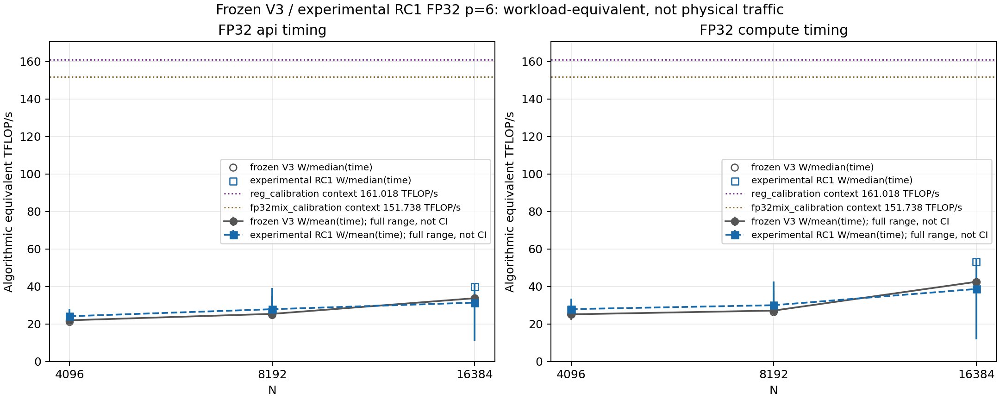

# 8454H：V3 冻结后的 V4 roofline 搜索结果

本轮已完成。当前代码版本为 **0.4.0**，采用了有范围限制的 FP32 宏块优化。最终实际主代码的逐次交替对照中，N=4096/8192 的完整 API 平均耗时分别降低 **4.1%/7.6%**。这些是共享机器上的本批观测值，不是硬件性能保证。本轮仍未接近 AMX 热寄存器校准上限。

## V3 冻结与新版本身份

V3 论文对齐补测完成 40 项主表、18 项线程扩展、8 项 raw BF16，共 **66/66**，每项十次计时。旧 `v3_release` 的 309 项和补充 `v3_paper_release` 的 447 项均逐项校验通过；[完整性审计](../bench/8454h/roofline_v4/archive_integrity_audit.json)记录的是采用 V4 改动之前的源码及冻结包核验。冻结库 SHA-256：`73f0764610072b05a3e50afb8ce312fe6b717c361efef7b94e52f20bde63b42c`。补充冻结包的 manifest SHA-256：`cc0e6bab8b5f0d7785988e551d3de2a38ac056e366530b749c06d6394772e0d1`。详见[论文对齐报告](8454H_V3_PAPER_ALIGNMENT.md)。

当前通过验证的 OpenMP 库 SHA-256：`7adcc98996d5a88aa21f74038a42710a28496cf601f2127c016b8e8687801b68`；无 OpenMP 库：`c3baf4364d7dbf7b22e12a7f2662b7c03bc9ebd2696f86564e84f1cc800abe27`。八文件身份范围中只有 CMakeLists 的版本号和 `src/gemm.cpp` 有变化。源码、准确链接的库、原始数据、失败日志及命令将保存到 `bench/8454h/versions/v4_roofline_search_round1/`；该包包含实验记录和独立的 `adopted_current_main`，实验候选的通过不表示它已被采用。

## 采用的实现

默认 `CACHE_BLOCK=128` 时，FP32 满足 `4096 <= min(M,N)`、`max(M,N) <= 8192`、`4096 <= K <= 8192`，使用 **256×256** 输出宏块。BK=256、K32 内部累加和六项产品加法顺序、64 B 行 padding、原非有限检查、私有结果提交及工作区缓存语义保持原有设置。其它域使用已有路径；FP64 各档预算的计算几何没有采用本轮试验改动。用户显式选择非默认 cache block 时也沿用对应配置。

这条范围约束来自复核结果：精简候选在 N=4096/8192 FP32 的均值收益重复出现，而 N=16384 的候选均值因保留的慢样本发生反转；FP64 p6 在独立 N=4096 检查中也没有重复此前收益。因此选择的是经验证的局部改动，而非对所有尺寸的速度承诺。

近似当前 BK 的 FP32 数值载荷从原宏块约 1228 KiB 降到约 1044 KiB，包含三片 A/B、C 及一个临时结果。它是逻辑容量估计，不是缓存 miss 或 DRAM 流量测量。更多推导见[成本模型](8454H_V4_COST_MODEL.md)。

## 实际主代码验证与性能

OpenMP 和无 OpenMP 各通过三项 CTest。完整对照门通过 **23/23**：原二十项加上 4097×4099×4096 的 padding/完整输出、符合优化范围的大矩阵 A=C 别名，以及溢出后整个 caller C 保持不变。无 OpenMP 的 4096³ 完整输出也与冻结 V3 逐字节一致。所有对照保留私有 C 的异常事务语义。

最终性能由两个持续存在、分别静态链接主代码与冻结 V3 的进程逐次交替测量。固定 64 个物理核、CPU 0–63、输入 seed、线程绑定和 2 GiB 缓存；使用 GNU OpenMP 默认等待设置，每次调用后的 20 ms 等待在 API 计时外。每项检查完整输入哈希、完整 C 哈希及实际 64 个 worker 的 CPU 放置。完整 API 包括分片、打包、计算重建和相关分配/释放。保留全部样本，不删除离群值。

| FP32 方阵 | 配对次数 | V3 API 均值 | 当前 API 均值 | 当前/V3 均值比 | 更快调用数 |
|---|---:|---:|---:|---:|---:|
| N=4096 | 11 | 34.2623 ms | 32.8583 ms | 0.9590 | 10/11 |
| N=8192 | 11 | 273.2435 ms | 252.5215 ms | 0.9242 | 11/11 |

N=1024 和 N=16384 的原路径回归亦保留；其中明显的主机波动不能当作这些原路径被优化的证据。[主代码验证报告](8454H_V4_CURRENT_MAIN_VALIDATION.md)包含完整 raw、阶段时间、库和源码身份、数值门，以及独立 oneMKL 补测。

## 搜索空间与循环结果

累计 **65 组计时参数配置**：29 组分块/重建 batch、16 组打包间隔/分量轮转、8 组 AVX-512 重建开启/关闭、6 组 padding/加载提示、4 组页面对齐/大页提示、2 组 AMX 加载分组。部分配置是控制或重复参数，不把这个数当成 65 个独特算法。另一个默认 OpenMP 栈下失败的宏块配置及未过精度门的 INT8 原型不计入有效计时配置。

| 循环 | 实现与验证 | 分析及采用结果 |
|---|---|---|
| 实际地址诊断 | control、取消逐次检查、去重建及 Late32；90 个配置、各五次 | 去重建 p21 compute 约少 19%，但该路径没有有效数值输出；Late32 没有稳定 API 收益 |
| 新校准 | 57 个配置，预热加三次计时 | 热寄存器 161.018 TFLOP/s；提供不同工作集的局部参考 |
| INT8-36 | 手写 AMX、SIMD 打包、整数累加还原；十六种质量 case | K=1、稀疏与动态范围案例未过精度门；未运行性能矩阵 |
| 宏块与 batch | 29 组有计时，全部快速门通过；一个默认栈失败被排除 | 留下几何候选，再做完整门、交替对照及独立复核；最终采用上述 FP32 范围 |
| 打包布局 | 十六组完整二十项门通过 | 间隔无稳定收益；修正 slab 为 16 KiB、面板为 128 KiB 的容量模型 |
| AVX-512 重建 | 手写八条累加链；直接 probe、ABI、特殊值及完整门通过 | 局部几百分点变化与大波动并存，未采用 |
| padding/加载提示 | 六组快速门；最有希望的替代布局补完整门 | 预算之间有明显取舍，保留 64 B padding |
| 页面布局/THP | 四组完整门；实测 hint 成功和 AnonHugePages；二十项交替复核 | 大页确实获得，但均值/中位数与位置效应分歧大，未采用 allocator 变化 |
| AMX 加载分组 | 两种手写调度、反汇编、完整门；八项十一对配对 | 同样四次加载/四次点积，收益不稳定，未采用 |

每轮的假设、实现、失败、profile、分析及下一次修改保存在[搜索日志](8454H_V4_SEARCH_LOG.md)及其链接的报告中。两种精简 RC 和最终主代码均有单独记录，不能把 RC 的 N=16384/FP64 实验结果混作当前采用路径。

## Roofline 所显示的差距

本轮单独校准的 AMX 热寄存器等效峰值为 **161.018 TFLOP/s**。热小工作集的 FP32 产品加重建约 **151.738**，FP64 p6/p21 加重建约 **84.423/86.306**。它们省略实际大矩阵地址跨度、全 API 和部分初始化成本，也与最终 API 测量不在同一时间窗口。

最终主代码 N=8192 FP32 的 compute/reconstruct 均值 234.935 ms，计入六项产品后的 `2*N³*6/time` 为 **28.080 TOP/s**；完整 API 对应约 **26.126 TOP/s**，用户原矩阵的常规 `2*N³/API` 约 **4.354 TFLOP/s**。28.080 与 151.738 的数值比约 18.5%，仅表达两种测量口径的距离，不能称为硬件利用率或可直接兑现的 5.4 倍加速空间。

不能将这个 gap 归因于已测得的 TLB、L2 或 DRAM miss：`perf_event_paranoid=4`，没有 PMU 物理流量数据。新加载调度没有消除差距；大页实证也未形成稳定 API 收益。后续重点是取得匹配工作集的供数/NUMA/缓存证据，或重新设计组件复用与工作分配，而不是把热寄存器峰值当成完整 GEMM 的已证明上限。

图为 **experimental RC1** 的独立确认，主点使用 `work/mean(time)`，空心点使用中位数，全样本范围不是置信区间。它用于选择当前 guard；N=16384 RC1 及 FP64 RC1 不等于当前采用的实现。逐配对散点保留全部离群点，见[图表和可复算数据](../bench/8454h/roofline_v4/round_analysis/figures/round_plot_data.json)。

## oneMKL 与机器基线

新增 oneMKL 2026.1/GNU、64 线程的独立十项补测：N=4096/8192、FP32 与四档 FP64，各三次。以完整 API 为口径，FP32 的 `MKL GEMM/API` 比分别约 **1.120/0.626**；这些单独时段与主代码/V3 交替测试不同，不能拼接为同批加速比。FP64 预算有不同精度，性能比较也不表示精度等价。oneMKL 原 CSV 仅保留 MKL 三次均值，缺少其逐次分布，报告明确记录了这一限制。

独立小矩阵 verbose 日志核实版本、GNU 层、64 线程及 advertised AVX-512/AMX 支持；它不证明每个 routine 的实际指令。两份 [Intel ISA dispatch](https://www.intel.com/content/www/us/en/docs/onemkl/developer-guide-linux/2026-0/instruction-set-specific-dispatch-on-intel-archs.html) 和 [verbose 说明](https://www.intel.com/content/www/us/en/developer/articles/technical/verbose-mode-supported-in-onemkl-112.html)已下载到 third_party/manuals，原连接失败和授权重试 metadata 均保留。

最终机器测量口径、硬件环境、V3 论文精度局限及 V4 结果入口见[当前机器性能基线](8454H_CURRENT_BASELINE.md)。本轮保证的是已测试输入与冻结 V3 的结果/事务一致性，不宣称修复了 V3 FP64 相对论文的精度差距，也不宣称找到了全搜索空间的最优解。
