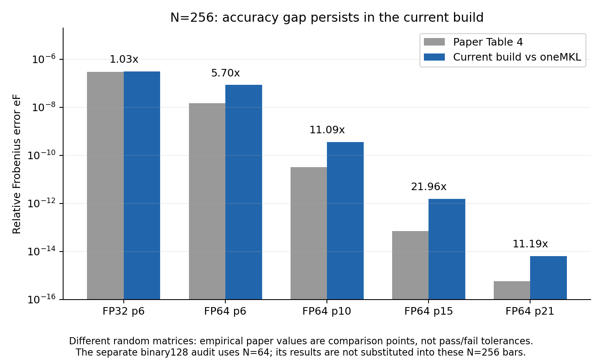
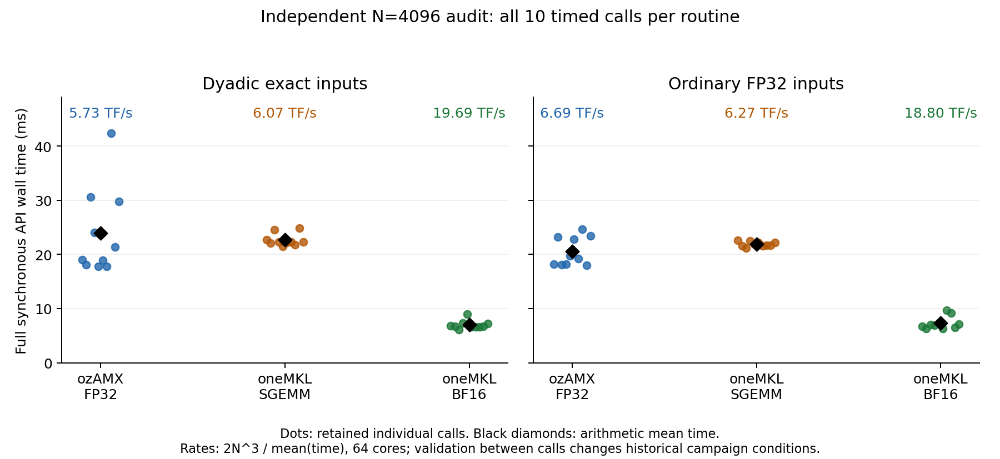

# ozAMX 论文复现、实现、实验计量与工作区综合审查

审查日期：2026 年 10 月 15–16 日（Asia/Shanghai），10 月 16 日完成独立验证与最终复核。对象：`/home/caiweili/ozAMX` 当前工作树，以及本地论文 `third_party/papers/2609.04663v1.pdf`。论文 SHA-256：`11981bb2fc8be3d492a82aeb23898ee2ac999c1d5660fdd3c7fc2438615ef70f`。

本报告记录审查与诊断，不实施生产算法、API、基准驱动或测试源码修复。新增内容是审查文档、独立审计附件及本轮证据；清理只涉及可恢复的生成元数据。用户原有的 `src/gemm.cpp` 未提交修改和 `docs/PAPER_SECTION_6_3_IMPLEMENTATION.md` 均保留。

> 交付状态：审查完成。第 8 节是全新独立计时与正确性验证，第 10 节是新增的 FP64 全矩阵高精度对照。旧 CSV 的算术自洽不替代独立验证；性能的单一根因和作者未公开的实现细节仍未确定，见第 9、14、15 节。

## 1. 先回答最终目标

当前问题由两条不同的差距组成：**FP64 的误差差距，主要证据指向公开字面分解及产品截断；性能差距则混合了具体实现的数据流、接口成本与很强的测量状态变化。** 不能用一个“AMX 没优化好”或“吞吐单位写错了”包办解释。

现阶段支持以下判断：

1. 当前实现的核心数学构造大体对齐论文：FP32 三片六积；FP64 正 shift、ρ=45、六轮投影、三角产品集合、独立 FP32 组件结果转 FP64。没有发现把 FP64 多个组件积先合并成 FP32 的重大错误。它是独立实现，不能称为作者实现的逐行复现。
2. 实现细节并非完全对齐：输出宏块、块本地输入 staging、预处理任务分配、低预算存储策略、FP64 batch2、异常保护、整个私有结果矩阵、tile 配置计时等均有差别。有些差别是为性能或接口语义有意引入；不能只把 `BM=BN=BK=256` 常量视为真实输出调度。
3. FP32 精度接近 Table 4，而 FP64 的 p6/p10/p15 误差在完整八尺寸数据中分别稳定偏大约 5.70/11.15/21.92 倍。当前新构建的 N=256 p21 对 MKL 的 `eF=6.3872768e-15`，论文为 `5.71e-16`，差约 11.19 倍。
4. 独立高精度分解计算仍出现约 `6.40764e-15` 的 selected-21 误差；逐组件 AMX store 的核验没有显示对应误差。这使“优化硬件内核就能修复 FP64 论文精度”缺乏支持。
5. TFLOP/s 量级有独立实测支持；已核查的现有 CSV 没有统一的 1000 倍单位计算错。**但公式算对、旧测试通过、计时记录自洽，都不是完整工作与正确结果的独立证明。** 本次另建程序，已完成 198 次调用：N4096 普通 FP32 的 ozAMX 为 6.6850 有效 TFLOP/s、SGEMM 为 6.2730、raw BF16 为 18.8035；验证条件和限制详见第 8 节。
6. 确有指标与证据管理问题：profile/API 混淆风险、组件工作率/有效 GEMM 工作率混用风险、跨批漂移、相同 seed 不同矩阵、续跑身份隔离不足、过时的 current 标签、弱于论文目标的测试门、陈旧的非默认测试文件。
7. 新 V4 的已采用收益是一个有限域的 FP32 优化，保存的 matched 结果约减少 4.1%/7.6% 的 API 时间；不能据 RC 的其他实验域，宣称全部尺寸或 FP64 都已优化。

本报告不会把未测得的 PMU 流量、未观察到的持续频率、作者未公开的代码或随机输入当作事实。结论按“确定事实／证据支持的解释／待判别假设”分层。

## 2. 报告与证据导航

| 附件 | 内容 |
|---|---|
| [论文与概念复核](PAPER_AND_CONCEPT_REVIEW.md) | 29 页原文、公式与页码、投影格距、条件性精确点积、作者未披露信息 |
| [基准专项审查](BENCHMARK_REVIEW.md) | 66 个 CSV 重算、V4 配对、161 TFLOP/s 计数展开、统计、续跑及指标问题 |
| [实现定点监察](IMPLEMENTATION_SPOT_REVIEW.md) | 真实宏块、staging、batch2、线程、tile 配置与事务成本 |
| [逐文件清点](FILE_INVENTORY.md) | 初始所有普通文件的数量、字节、Git 状态、重复内容及范围 |
| [完整机器可读清单](file_inventory.json.gz) | 初始文件路径、完整 SHA-256、大小、状态；gzip 压缩 |
| [文档覆盖与链接检查](DOCUMENT_COVERAGE.md) | 53 份笔记、331 个本地链接、结果路径及机械 checksum 检查 |
| [归档边界复核](ARCHIVE_INTEGRITY.md) | 顶层清单全部通过；解释嵌套旧清单表面失败 |
| [独立验证协议审查](INDEPENDENT_PROTOCOL_REVIEW.md) | 独立正确性与双时钟方法的条件和限制 |
| [独立程序代码审查](INDEPENDENT_HARNESS_REVIEW.md) | 对新审计程序的定点代码监察 |
| [独立结果监察](INDEPENDENT_RESULTS_REVIEW.md) | 198 次调用重算、挑战文件、负控重放和 FP64 数值核对 |
| [独立程序与重现说明](independent/README.md) | 两份新源码、编译运行范围、分析脚本、原始证据与限制 |
| [本轮数据重算](evidence/recomputed_summary.json) | 新测量及 V3 原始数据的重新计算结果 |
| [会话来源记录](evidence/session_provenance.json) | 新构建、环境白名单、CPU affinity、库 hash、时钟与平台信息 |
| [清理结果](evidence/cleanup_result.json) | 清理项目、备份 hash、可恢复命令 |

### 2.1 “所有文件”的覆盖含义

初始清点覆盖 29,376 个普通文件，逻辑大小 874,824,817 字节；排除 `.git/`、`.aws/`、`.codex/`、`.agents/` 内部内容。逐个可读普通文件均计算完整 SHA-256；没有不可读文件或符号链接。Git 中 6,421 个 tracked 文件，22,954 个 ignored 文件，另 1 个用户未跟踪论文笔记；审查附件不计入这个初始口径。

语义审查重点为全部生产源文件、公共接口与构建入口，基准驱动、实际采用路径的 runner/分析器、验证程序、项目研究文档、关键原始数据、冻结清单及相关 Intel 原始资料。生成的 Make/CMake 样板、重复快照、二进制库按用途、来源与哈希检查，不把 29,376 个文件都声称为逐行人工语义阅读。第三方大型手册按相关 ISA/AMX 章节阅读，未假称从头读完所有 Intel 手册。目录清点、内容阅读、执行验证是三个不同覆盖等级。

源码树没有发现 `AGENTS.md`。审查时未读取凭据目录，没有改变系统频率、THP、BIOS、内核或全局依赖。

## 3. 当前究竟是哪一版

| 身份 | 说明 | 关键标识 |
|---|---|---|
| 当前 Git HEAD | 本轮开始前的工作区整理提交 | `b5523b1` |
| 用户 dirty 源码 | `src/gemm.cpp` 增补注释/排版 | SHA `f1e9e9ca…928a` |
| 冻结 V3 库 | 完整论文对齐 campaign 的实现 | `73f07646…b42c` |
| 已验证 V4 库 | 采用有限域 CompactWide FP32 调度 | `7adcc989…1b68` |
| 本轮从当前源码全新构建 | `/tmp/ozamx-audit-20261015-build/libozamx.a` | **与已验证 V4 完整 SHA 相同** |

源码哈希变化不等于算法变化。本次核对八个文件的规范化 token，处理注释、空白、escaped newline 和相邻字符串后均一致；更强证据是当前重新编译出的静态库与已验证 V4 库字节相同。用户 dirty diff 与 HEAD 也只有注释/排版差异。详见 [source_identity.json](evidence/source_identity.json)。

因此，不能把本轮与历史测量的差异随意归因于“最新代码又变了”。但同库在不同日期、等待策略、内存状态和共享主机负载下的时间仍可不同。

`8454H_FINAL_PERFORMANCE_REPORT.md` 等历史文档仍有 “Current production is V3” 字样；它们应按当时版本阅读。真正较新的入口是 `8454H_CURRENT_BASELINE.md` 和 V4 实际主代码验证记录。历史 Gold 6430 的 `REPRODUCTION_RESULTS.md` 不能替代 8454H 当前数据。

## 4. 论文方法：复现需要抓住哪些实质

PDF 共 29 页，物理页码与页脚一致，没有封面偏移。**§6.3 位于第 16–17 页**；Figure 4 和 Eq.(19) 在第 15–16 页。用户未提交的第 6.3 节笔记把 PDF 页码整体加了一页，这是确定的定位错误，本次只在报告指出，不覆盖该文件。

### 4.1 FP32 三片与六项

对 A/B 每个 FP32 元素，从残差 `R0=x` 开始三轮：

```text
slice_r = RNE_BF16(R_r)
R_(r+1) = fl32(R_r - slice_r)
```

保留 `i+j<3` 的六项：00、01、10、02、11、20。省略 12、21、22 及涉及末端残差的项。论文 §4.2 的数学展示、Algorithm 1 的双循环与 §6.2 的物理顺序并不相同；实现应采用 Eq.(19)：

```text
11 → 10 → 20 → 00 → 01 → 02
```

当前 `src/kernels.S` 确实执行该链，每个 K32 步进 14 次输入 tile load、24 次 TDP。一次完整 BK256 是八个 K32 步，不能写成整个 BK 只有 14 次 load。四个 FP32 累加 tile 常驻，BK 完成后写 32×32 scratch，再加入线程私有 FP32 输出块。

这里存在原文未给出代码的歧义：当前是 K32 外、六项链内；不能仅凭数学 Algorithm 1 断言作者一定产品外、全 BK 内。两种浮点求和树一般不逐位相同。当前 FP32 精度接近论文，是经验对齐证据，不是作者循环层级的证明。

### 4.2 FP64 六轮投影

论文 §4.3，Eq.(13)–(14) 的字面公式为：

```text
v_r     = ceil(log2(max(abs(R_r))))
sigma_r = 2^(v_r + 45)                  // 正 shift
Z_r     = fl64(fl64(R_r + sigma_r) - sigma_r)
slice_r = RNE_BF16(Z_r)
R_(r+1) = fl64(R_r - slice_r)            // 共六轮
```

不是直接对 FP64 残差做 BF16 rounding，也不是随元素符号变化的 shift。当前普通和 direct-packed 路径都保留六轮、正 σ、ρ=45。低预算只保存会用到的 3/4/5/6 片，但六轮仍执行并做域检查。

| 产品预算 | 对角深度 d | 产品集合 | 当前实际保存片数/侧 |
|---:|---:|---|---:|
| 6 | 3 | i+j<3 | 3 |
| 10 | 4 | i+j<4 | 4 |
| 15 | 5 | i+j<5 | 5 |
| 21 | 6 | i+j<6 | 6 |

每个选中的组件积先完成本 BK 的 BF16×BF16→FP32，独立 store，再 widen 到 FP64 并按既定顺序加入输出。当前以对角线递增、线内 A 片编号递增执行；论文 Algorithm 2 线内只写 for all，没有唯一指定同对角线内顺序。

### 4.3 范围与非保证

论文的数学问题定义为一般 m×k 与 k×n 实数矩阵的 C=AB，报告的性能与精度实验仅覆盖方阵；没有实验覆盖通用 alpha/beta/transpose 接口。FP64 输入限制在 BF16 normal 指数范围，且残差片、中间 FP32 产品/累加也必须处于支持范围。它不承诺通用 DGEMM 精度、所有输入都单调随产品数改善、正确舍入或逐元素等同 MKL。

论文对“非零残差投影为零”和“指数下溢到零”的文字不够统一；精确零明确允许。当前实现允许部分量化零，拒绝非零 subnormal。该边界在均匀 [-1,1] 主实验中不是主要差距解释，广域接口需要另行定义。

## 5. 实现对齐表与性能含义

| 层次 | 论文 | 当前实现 | 审查判断 |
|---|---|---|---|
| 组件构造 | FP32 三片；FP64 六轮ρ45 | 相同核心递推 | 高度对齐，仍需作者 shift 作用域澄清 |
| 产品集合 | 六项／6、10、15、21 项 | 相同三角集合 | 对齐 |
| FP32 tile 内复用链 | Eq.(19) | 每 K32 执行同链 | 链对齐，嵌套未唯一披露 |
| AMX tile 映射 | 2A+2B+4C，32×32 | 同映射 | 对齐 |
| BK 归约长度 | 256 | 256 | 对齐，兼有数值意义 |
| 真实输出宏块 | 固定256×256 | 小32×32、中128×128、大自适应 | 未完全对齐 |
| 输入 staging | 全片预计算，复制所需256面板到块本地缓冲 | 全局 tile-contiguous packed 数据直接供数 | 数据流不同，可能改变局部性与复制成本 |
| FP64 重建时序 | 每产品立即 store/widen/add | 大域先收集两个独立 scratch，再按原序 widen/add | 物理时序不同；有限支持域中加法顺序保留 |
| 低预算片存储 | 六片预计算/打包 | 六轮提取，保存 depth 片 | 减少存储，不能称数学算法少分了几轮 |
| 异常与别名 | 论文不提供完整异常/fallback接口 | 域检查、非有限检查、C别名及事务保护 | 额外接口行为及成本 |
| 最终结果提交 | 私有块完成后写C | 私有块→完整私有M×N结果→caller C | 额外全矩阵写/读及分配 |
| tile 配置计时 | compute计时前配置 | worker配置/release在compute阶段 | 确定计时差异，尤其小矩阵需注意 |
| 预处理并行 | 按宏块static | 向量chunk并行，全局max规约 | 调度/同步结构不同 |

### 5.1 实际宏块，不要被变量名误导

默认 CACHE_BLOCK=128：

- `min(M,N)<1024`：32×32。
- 中域：128×128。
- FP32 满足 4096≤min(M,N)、max(M,N)≤8192、4096≤K≤8192：256×256，且含每行 64B padding。
- 其他大 FP32：128×512。
- 大 FP64 p6/p10：128×512；p15/p21：128×256；均含行 padding，使用 batch2。

`BM/BN=256` 同时作为 packed panel 的索引单位；它不等于每个输出任务一定是256×256。代码位置：`src/gemm.cpp:464` 的 cb/cbn、`:561` 之后的 dispatch。

### 5.2 线程数必须拆成三层

| N | 论文固定256块的输出任务数 | 当前FP32输出任务数 | 当前compute team上限 | 当前prep上限 |
|---:|---:|---:|---:|---:|
| 256 | 1 | 64 | 8 | 4 |
| 512 | 4 | 256 | 32 | 16 |
| 1024 | 16 | 64 | 64 | 64 |
| 2048 | 64 | 256 | 64 | 64 |
| 4096 | 256 | 256 | 64 | 64 |
| 8192 | 1024 | 1024 | 64 | 64 |

这些是源码推导的任务/team上限，不能当作新 PMU 观测。论文配置64线程，不表示小矩阵64个线程都有有用compute工作；当前普通 benchmark 的 threads=64 也不表示每阶段真实 team 都为64。matched ready 阶段的64 worker核对只证明 ready 团队，不能代替内部各阶段观测。

### 5.3 哪些差异可能解释性能，哪些不能解释精度

宏块、staging、NUMA、等待策略、全结果提交、tile配置、规约同步可以影响耗时；在保持每元素浮点操作顺序时，它们不能把稳定的 FP64 截断误差压低十倍。反过来，改变 shift、片数、BK 或选中集合可以改变精度，也可能改变性能，但那已经不再是同一个字面算法，不能拿来当纯工程修复。

当前 batch2 并没有先把两个 FP32 组件加在一起；它把两个独立 store 的 FP32 值分别拓宽后，按原顺序加到保留在 ZMM 的 FP64 累加值。不能因“先存两个”就指控它破坏了 FP64 重建。

## 6. FP64 精度差距的证据链

### 6.1 本轮当前库复测

使用当前重新构建的库、uniform[-1,1]、seed=260904+N、N=256、一次预热和十次调用；精度是完整输出相对同输入 oneMKL。程序为原有 benchmark，故这部分属于现有工具复跑，独立验证另列。

| 模式 | 本轮 eF vs MKL | 论文 N256 eF | 倍率 |
|---|---:|---:|---:|
| FP32 p6 | 3.1206311e-7 | 3.02e-7 | 1.0333 |
| FP64 p6 | 8.4918009e-8 | 1.49e-8 | 5.6992 |
| FP64 p10 | 3.6153500e-10 | 3.26e-11 | 11.0900 |
| FP64 p15 | 1.5263684e-12 | 6.95e-14 | 21.9621 |
| FP64 p21 | 6.3872768e-15 | 5.71e-16 | 11.1861 |



图中倍率来自不同随机矩阵的经验值比较，并非逐项公差或相同输入实验。原始数据和绘图脚本保留，可导出 [PDF](figures/n256_accuracy_gap.pdf)。

再次独立进程调用 N256 p21 得到相同 eF，记录见 [gap_reproduction.log](evidence/gap_reproduction.log)。其中 ratio>5 只是调查触发器，不是论文给出的合格阈值；不同 RNG 输入不能要求每个论文小数逐位相同。

### 6.2 不经过生产内核的分解诊断

重跑 `tools/diagnose_fp64.py`，PCG64 seed=20261012，按64/128/256顺序生成输入；NumPy2.2.6，longdouble为64位有效精度的x87 extended，**不是binary128**。不调用生产 GEMM。与旧诊断使用不同 NumPy 版本，主要量级一致。

N256 的结果：

| 数值对象 | 相对 longdouble AB 的 eF |
|---|---:|
| 六片完整36项，即仅保留终端残差误差 | 4.0323346e-15 |
| 终端项 R_A B + (ΣA片)R_B | 4.0323352e-15 |
| 遗漏的 i+j≥6 共15项 | 5.0015168e-15 |
| 选中21项的高精度结果 | 6.4076426e-15 |
| 每组件先FP32再widen的selected21结果 | 6.4076426e-15 |
| selected21 FP32结果相对高精度selected21的差 | 0（本例） |

12片均可精确表示为BF16，无非零subnormal。六层典型 v 为0、−8、−16、−24、−32、−40；末端残差不为零。误差矩阵恒等式的重算余量约为1e-19相对量级；不是把不同范数机械相加。

这个结果支持“终端残差＋遗漏产品已足以产生当前误差量级”。它不证明论文造假，也不证明作者必定用了其他算法。该诊断脚本仍属于既有工具，须与新增独立验证区别；本次通过公开公式、不同参考与真实AMX逐组件检查交叉解释，不把单个脚本当最终权威。

### 6.3 为什么不能说FP32累加必有1e-7地板

公共正 shift 的格距具有正负不对称性：正残差在 σ 上方，间距为2^(v−7)；负残差在σ下方，间距为2^(v−8)。统一最细公共网格 q=2^(v−8)，片值可写为 l·q，|l|≤256。

若A/B各片在该归约范围内共享尺度，且没有指数范围损失，则BK≤256时，组件dot所有部分和的整数绝对界≤256³=2^24。FP32可以精确表示这个范围的整数。因此这种特定格点结构下组件partial可以精确，不能套普通任意BF16输入的误差直觉，断言一定有1e-7地板。

本轮原生逐组件审计检查147,456个FP32 store，全部与longdouble dot舍入后的值一致；packing/padding和730个重建输出也无不一致。store 与高精度舍入结果一致本身只检查最终 FP32 值；点积精确的判断另依赖上述格点充分条件、第 6.2 节本例 selected21 delta=0 和第 10 节逐组件转换无变化的证据。这个既有审计测试覆盖的是所列小形状，不是对所有维度的证明。

### 6.4 signed-shift线索的地位

既有单输入 N256 诊断改为 `copysign(2^(v+44),R)` 后，p6/p10/p15约为1.4936e-8、3.2691e-11、6.9636e-14，接近论文对应表值；p21对MKL约5.48e-16。

这是值得作者确认的线索：改变投影分辨率确实可能改变完整误差谱。它不是“我们发现作者实际公式”的证据；该诊断是另一方法、单seed，且历史MKL版本不同。直接改默认ρ、改符号或换直接BF16残差，以表值为目标反向调参，会把方法差异掩盖起来。本次没有这样做。

## 7. 吞吐量、计时与论文单位

### 7.1 四种工作率必须分清

| 指标 | 分子 | 分母 | 用途 |
|---|---|---|---|
| 有效GEMM吞吐 | 2MNK | 完整API墙钟秒 | 应用要完成的C=AB；论文主指标 |
| 组件工作等效速率 | p·2MNK | API或compute秒，必须注明 | 组件成本分析，不能替代有效吞吐 |
| raw BF16 GEMM | 2MNK | oneMKL BF16 routine墙钟秒 | 单个BF16 GEMM headroom |
| 热tile AMX校准 | TDP指令数×每指令操作数 | 局部循环墙钟秒 | 特定热工作集的局部参考 |

`2MNK` 是传统的数学工作量归一化，FMA计两次；它并不证明物理上恰好执行了2MNK条操作。组件方案实际需要更多工作；更快算法也可能使用不同物理操作数。FP64模拟的有效TFLOP/s也不意味着AMX原生支持FP64运算。

```text
GFLOP/s = 2MNK / 秒 / 10^9
TFLOP/s = 2MNK / 秒 / 10^12
GFLOP/s / 1000 = TFLOP/s
```

N4096的2N³为137,438,953,472。若耗时35.10ms，有效吞吐约3.92TFLOP/s；不是1374亿就只能报GFLOPS，因为这里还要除以0.035秒。

### 7.2 现有主driver的确定口径问题

`bench/benchmark.cpp:420` 的 `effective_GFLOP_s` 用 `mean(profile_total)`；`:430` 另存完整 `api_call_wall_s_mean`。profile从内部t0到t3结束，函数返回前的局部对象析构、缓冲释放/归池等不全在其中；外部wall包住完整调用。

在V3 N32768 FP32：

- profile均值20.36935094s；完整API均值22.28681879s。
- profile吞吐3.454639TFLOP/s；完整API3.157415TFLOP/s。
- 把前者当完整API会高报约9.4135%；不能据此声称存在1000倍单位错。

最新版论文对齐分析器已经从raw API wall重算headline；原CSV旧字段仍容易被其他脚本误读。本轮前面的3.92TFLOP/s同样用完整API重算，没有使用较短profile。

### 7.3 为什么161、28与4可以同时出现

保存的N8192 matched V4数据：完整API均值0.252521499545s，compute/reconstruct均值0.234934993909s。

```text
2N³/API                  = 4.354130756 TFLOP/s
6×2N³/API                 = 26.124784537 TOP/s（组件等效）
6×2N³/compute_reconstruct = 28.080404953 TOP/s（阶段组件等效）
```

约161TFLOP/s来自独立的热tile循环。保存的一个样本为196,574,976个unit，每unit四个TDP，每个满形状TDP计16,384FLOP，耗时0.080008062s，反算161.017993751TFLOP/s。计数公式能闭合，仍需把它视作特定微基准；本轮没有把这项旧微基准重测为独立结论。

不能用28/151.7或4/161就宣布硬件利用率，也不能据差距直接承诺5倍以上可兑现API加速。工作量、工作集、时段与边界均不同。

### 7.4 论文GFLOPS标签的疑点

本次直接渲染核对Figure6/7：原图轴和caption确实写GFLOPS，例如N16384 raw BF16为38.08。该点若真为38.08GFLOP/s，按论文公式反算约231秒；若为38.08TFLOP/s，则约0.231秒。本地旧raw测量约0.2266秒、38.81TFLOP/s，使“图中单位可能误标”成为强烈但尚未被作者原始秒数证实的怀疑。

应保留原始标签，不能静默把论文改成TFLOPS，也不能据这个印刷标签倒推本机TFLOPS必错。图内同单位的速度比不受统一1000倍标签影响，故该疑点无法解释本机未得到论文加速比。

## 8. 不信任既有测试之后：全新独立核验

用户进一步明确“现有的所有测试内容都不要轻易相信”。因此，前述旧CSV重算、旧审计程序复跑都降为交叉证据；新建 [independent_gemm_benchmark.cpp](independent/independent_gemm_benchmark.cpp)，没有include或调用任何现有benchmark/test实现。被测对象仍是当前生产库及oneMKL；数学oracle和计时由新程序建立。

最终审计源码SHA-256：`dcee461b4f64fa7092fe630c711b9d60d7af2fdb6ec2cec16ad6e982aa7cae6d`；可执行文件SHA：`825ffc90a2eee2761b3002a8ac75d6a897e39815af50c928b9246893b3f69bd6`。源文件、二进制、生产库、oneMKL runtime、编译命令及环境另见 [独立运行provenance](independent/run_20261016/provenance.json)。程序执行前由6.1 Sol做定点代码监察，由Astra medium复核上层协议；发现的三个缺口均在执行前修补，不用“另一个agent说通过”替代实际数据。

### 8.1 新程序怎样形成闭环

- 对每组尺寸128、1024、4096，分别测试dyadic受控输入和普通FP32随机输入。每组一次预热、十次计时；ozAMX FP32、oneMKL SGEMM、raw BF16三个routine的顺序在每轮洗牌。共198次调用，其中180次计时，18个配置。
- 每轮改变A；普通FP32输入改变所有输出行的相关点积输入。每次调用前把整个C填成NaN；调用后扫描整个C、消费整个输出hash，并核对真实输入A/B没有被改写。
- 计时包住公开API的同步返回，调用参数始终为完整N×N×N、row-major、ld=N。数据生成、poison、hash、oracle、随机挑战、写盘都在计时外。完整生产API包括自己的预处理、计算、提交与清理。
- 同时记录CLOCK_MONOTONIC_RAW和steady_clock的秒数；另记进程全部线程user+system CPU秒。CPU秒只用于占用检查，不用作TFLOPS分母。两个墙钟读取路径可核对单位/边界，但通常不代表两个独立物理时钟。
- 所有样本保留。主吞吐统一用`2N³/mean(raw_wall_seconds)/1e12`，不把每次吞吐取平均，也不挑最快的一次。

文件输出遇到failbit/badbit会报错；随机读取遇EINTR会重试。运行后另外核对CSV行数、原始挑战区间/长度、文件hash，避免“程序说pass但证据丢失”。

### 8.2 dyadic输入的完整输出验证

A、B每项为[-8,8]整数除16，恰好可以表示为BF16/FP32；故`256C=AiBi`应为整数，每项绝对值≤64N。先检查整个C有限、严格落在格点、在界内，随后才转整数，不通过round/cast掩盖错误。

N128对全部16,384个输出逐项做独立int64点积参考。所有尺寸还做三个完整有限域随机投影：素数p=2,147,483,647；输出产生后从getrandom抽取向量，拒绝uint32的最顶端两个数后取模，得到严格均匀的域元素。检查`Cinteger*r = Ai*(Bi*r)`模p。

在N4096时，左侧整数绝对和严格小于2^61，右侧远小于int64界；若输出错误仍通过格点/幅度检查，其误差项绝对值≤128N<p，不会整体因模p消失。三个新鲜独立均匀挑战的理论漏检界≤p^-3，约1.01e-28。这个概率声明依赖明确条件，**不是完整逐元素确定性证书**。

实际99个dyadic输出全部通过；按尺寸/轮次对照，三个不同routine的完整输出hash全部相同。每配置11轮的A和C hash均发生变化，B保持固定。随机挑战的101段（99个正常输出加2个负控）连续、无重叠，末端与文件大小均为2,102,784字节；全部525,696个uint32均在域内。

两项负控确实检出：N1024的一个元素加1/256，三个投影均报不一致；整块输出清零，三个投影合计3,072行不一致。负控未使用小矩阵逐项oracle，表明大矩阵的投影路径本身具有识错能力。负控完全在计时外。

### 8.3 普通FP32输入的独立参考

普通输入不是只有一个非零BF16片的受控特例。N128检查全部输出；N1024/4096每次用独立longdouble做512个点积参考，raw BF16按其真实BF16解码输入计算参考。大矩阵这里只是抽样精度诊断，不能写成全输出逐项精度认证。

输入落在2^-23格点，当前N≤4096时每个点积的绝对整数分子和≤2^58。本机longdouble有效精度为64位，故这些所检查的dot本身可精确表示。`5e-6`是审计的粗异常触发阈值，不是论文Table4的阈值；本次实际最大scaled误差远小于该阈值。

### 8.4 独立实测：TFLOPS量级成立

执行日期为2026-10-16（北京时间）。64物理核的整机结果，固定CPU0–63，GNU运行时、PASSIVE等待、十次算术平均；新协议包含每次调用之间的完整验证和输入变化，与旧campaign不是同一计时条件。

| N4096输入 | 被测例程 | API平均ms | 有效TFLOP/s | 进程CPU秒/墙钟秒 |
|---|---|---:|---:|---:|
| dyadic精确 | ozAMX FP32 | 23.9731 | 5.7331 | 51.41 |
| dyadic精确 | oneMKL SGEMM | 22.6571 | 6.0660 | 60.27 |
| dyadic精确 | oneMKL BF16 | 6.9790 | 19.6931 | 57.53 |
| 普通FP32 | ozAMX FP32 | 20.5592 | 6.6850 | 56.59 |
| 普通FP32 | oneMKL SGEMM | 21.9095 | 6.2730 | 62.11 |
| 普通FP32经BF16量化 | oneMKL BF16 | 7.3092 | 18.8035 | 53.73 |



图中保留每组全部十个正式样本，黑色菱形为时间算术均值；顶部吞吐由均值时间反算，没有按最好样本选择。另附 [PDF](figures/independent_n4096.pdf) 和 [绘图源码](figures/render_figures.py)。

**这轮不再只是旧benchmark内部自洽：从新计时器取得完整调用秒数，受控输入有全输出独立概率核验，普通输入有完整finite扫描及独立点积诊断，输出和输入保护均通过。证据支持本机实际具有数TFLOP/s有效FP32 GEMM、十余TFLOP/s raw BF16 GEMM的能力。**

180个计时样本没有错误输出标记、非有限结果或输入修改。两种墙钟的N4096组均值差约0.0082%–0.0196%，没有1000倍偏差。整进程外部`/usr/bin/time`报告42.36秒，包含大量单线程hash/投影/oracle和I/O；不能把整进程平均271%CPU当作GEMM只用了2.71个核。反过来，表中约51–62的CPU/wall比也不是AMX发射利用率。

普通FP32这一批的ozAMX/SGEMM有效速度比约1.066；它表明某些同机测量可胜过SGEMM，不能扩展为论文所有尺寸1.14–2.56倍已复现。dyadic低片为零，其性能不应直接代表普通FP32三片输入。这轮也**没有独立重测161TFLOP/s热tile微基准**，不借本轮结果给所有旧测试统一背书。

原始数据：[results.csv](independent/run_20261016/results.csv)；检查和分组：[analysis.json](independent/run_20261016/analysis.json)；外部时钟：[outer_time.txt](independent/run_20261016/outer_time.txt)；负控：[negative_controls](independent/run_20261016/results.negative_controls.jsonl)。独立另一位审查者的重算见[结果复核](INDEPENDENT_RESULTS_REVIEW.md)。

### 8.5 这些证据仍不能证明什么

没有对物理浮点指令计数，2N³是有效工作定义；没有全输出逐项验证大矩阵普通浮点误差；没有据此验证FP64论文精度；没有证明所有旧测试、所有形状或异常值都正确。完整finite/hash不是数学oracle；独立投影不是逐项证书；局部校准不是整机应用吞吐。报告后续的任何性能因果归因都受这些限制。

## 9. 性能差距：先看可比较的数据，再谈原因

### 9.1 完整V3论文协议覆盖，结果并未普遍复现

V3已有40主表、18线程扩展、8raw BF16，共66项完整记录，每项一次预热、十次计时。覆盖完整不代表数值或速度达标。FP32完整API重算为：

| N | 有效TFLOP/s | MKL时间/API时间 | 论文Figure7速度比 |
|---:|---:|---:|---:|
| 256 | 0.0599 | 2.220 | 2.56 |
| 512 | 0.3087 | 1.086 | 2.17 |
| 1024 | 2.4187 | 0.662 | 1.70 |
| 2048 | 3.0238 | 0.591 | 1.39 |
| 4096 | 3.3398 | 0.631 | 1.14 |
| 8192 | 3.4542 | 0.506 | 1.16 |
| 16384 | 2.3027 | 0.377 | 1.25 |
| 32768 | 3.1574 | 0.507 | 1.32 |

N8192按这个时段的MKL基准，若要从0.506达到论文1.16，API还需约2.29倍的加速；V4在另一批matched中减少7.6%时间，不能自动解释这段差距。但这个2.29也不是固定硬件差距，因为下一节会显示同库状态变化非常明显。

FP64还必须带预算和精度解释：论文自己也没有让p15/p21快过DGEMM。不能把“p21慢于DGEMM”本身判为复现失败；其主要复现问题是同预算精度较差，以及p6/p10的速度窗口未稳定出现。

### 9.2 同一个库跨时段大幅变化，是确定现象

| FP32尺寸 | V3主表API秒 | V3线程扩展t64 API秒 | 时间比 |
|---:|---:|---:|---:|
| 1024 | 0.00088785 | 0.00072684 | 1.22 |
| 4096 | 0.04115139 | 0.02191348 | 1.88 |
| 16384 | 3.81996691 | 1.57310776 | 2.43 |

这里同库、同driver、同seed规则，不是新代码提升了2.43倍。N16384主表两个很慢样本为10.49/7.65秒，但其余约2.44–2.58秒也仍慢于后续约1.50–1.67秒，因此不能靠删除两个“离群值”就解释全部差异。

V4保存的N16384 matched在未采用CompactWide的域中，均值时间比约0.60487，好像快39.5%；逐对比的中位数却约1.00014。它适合说明时间分布与主机状态变化，不能证明未改代码的域被优化。

### 9.3 确定存在的额外成本与合理假设

| 优先级 | 解释 | 现有支持 | 仍缺什么 |
|---|---|---|---|
| 高 | 真实大矩阵供数/局部性，与热小工作集差异 | 大矩阵组件阶段约28TOP/s，热混合约152；staging/宏块确有差异 | 同边界工作集和PMU流量，不能直接指定L2/TLB/DRAM |
| 高 | 运行状态/等待/页分配/共享主机变化 | 同冻结库跨批变化1.9–2.4倍，均值/中位数显著分裂 | 逐次频率、系统竞争、NUMA页分布与调度观测 |
| 高 | FP64 store/widen/add与产品数成本 | 代码每组件物化；既有无重建诊断约减少部分compute时间 | 控制同布局/同状态的独立阶段量化，诊断不能当有效算法 |
| 中 | 私有整结果、事务保护、检查及清理成本 | 源码可见，profile/API大N差额可测 | 各成本的独立因果份额，不能把全部差额归malloc或page fault |
| 中 | 输出几何与块本地staging未对齐 | 论文固定256块/本地copy，当前多种几何/direct global packed | 保持数值顺序的对齐实现或离线模型、受控A/B（本轮不改生产代码） |
| 中 | 编译器/OpenMP/平台不同 | 论文8462Y+/Intel运行时，当前8454H/GNU；频率策略不同 | 逐项控制实验；不能简单按base频率比例修正所有数据 |
| 较低 | 一个统一吞吐单位错误 | 主公式、旧CSV、新独立双时钟和oracle均未支持 | 若怀疑特定微基准，应单独检查，不概括全部测试 |
| 较低 | 当前最新源码实际换了算法 | 重建静态库与V4逐字节相同 | 当前证据已排除该解释 |

纸面roofline的字节数是指令逻辑载荷，现有机器`perf_event_paranoid=4`，没有相应物理cache/DRAM计数；THP页确实获得也不等于证明TLB是主因。`powersave`也不等于CPU固定800MHz或永不turbo。不能用这些标签替代测量。

### 9.4 已尝试的优化方向，不应再当未经验证的万能建议

仓库记录了输出几何、batch、padding、tile加载提示/分组、packed间距和地址轮转、手写重建ILP、THP、NUMA复制、工作区上限等探索。它们包含完整负结果、控制漂移和未采用候选。

- 最终只采用默认CACHE_BLOCK=128、FP32尺寸4096–8192的256×256输出块。实际主代码matched约降低4096/8192的均值时间4.1%/7.6%，没有据此采用全部FP64或N16384候选。
- THP与NUMA复制并未获得足够稳定的完整API收益；只看compute缩短可能忽略复制、缺页、分配成本。
- 去重建诊断的结果没有有效GEMM数值，不能列入产品性能榜。
- INT8-36原型在稀疏/小K/指数互相抵消输入上精度失败，未运行正式性能矩阵；不能拿理论整数吞吐代替实际加速。
- 工作区缓存上限是每caller线程的保留限额，不是活跃内存或RSS上限；warm-up不保证大于限额的buffer下次不再分配/缺页。

这些实验说明工程改善仍可能存在，也说明继续堆小参数搜索未必能回答论文方法差异。应先让测量状态与数学规格可判别，再决定要优化哪一段。

## 10. 新增独立FP64全矩阵数学对照

为避免只信任已有Python诊断，本轮又从论文公式单独写了 [independent_fp64_numerics.cpp](independent/independent_fp64_numerics.cpp)，不include任何既有benchmark/test，也不把MKL当真值。它用三个新seed生成binary64输入，独立执行正shift、ρ45、六片和四档三角产品；每个组件由binary128点积后转FP32，按顺序拓宽到FP64，再与当前公开API逐位比较。

形状为64×64×64，每个seed的全部4096个输出都校验。输入为2^-52格点，单dot的绝对整数分子和≤2^110；GCC binary128有效精度113位足以精确表示这些乘积/部分和。误差范数的平方和与最终输出仍是数值统计，不宣称每个范数无舍入。

| seed | p6 eF | p10 eF | p15 eF | p21 eF | p21终端项量级 | p21遗漏项量级 |
|---:|---:|---:|---:|---:|---:|---:|
| 20261016 | 8.5879e-8 | 3.6324e-10 | 1.5375e-12 | 6.4150e-15 | 4.0056e-15 | 5.0389e-15 |
| 260904 | 8.7054e-8 | 3.6394e-10 | 1.5345e-12 | 6.4575e-15 | 3.9469e-15 | 5.0917e-15 |
| 8454 | 8.4627e-8 | 3.6526e-10 | 1.4796e-12 | 6.3920e-15 | 3.9490e-15 | 4.8601e-15 |

以上eF均相对该输入的完整binary128 AB。12个配置中，当前AMX结果与独立重建**全部逐位一致**；组件点积转FP32改变数均为0。这是新参考、新输入、完整输出所得，强化了“这个受控范围内native实现按字面公式运行，字面分解、三角选择及FP64重建共同复现了该误差”这一判断。double重建舍入尚未单独隔离；表中终端项与遗漏项是误差矩阵的范数，不能直接相加，更不能据此声称已唯一分解全部误差来源。

但N64不是论文Table4的N256输入，不能拿这些数直接计算作者表值复现倍率；K64不跨BK，也不覆盖FP64 Wide/Batch2大尺寸路径。该程序不计性能，不能用它推断FP64整机吞吐。作者究竟采用了什么shift/作用域/末端处理，仍需作者代码或明确伪码。

数据：[fp64_numerics.csv](independent/run_20261016/fp64_numerics.csv)；执行状态：[fp64_numerics.log](independent/run_20261016/fp64_numerics.log)。

## 11. 确定问题清单：不把线索一律写成bug

| 编号 | 问题/缺口 | 依据与影响 | 本次处置 |
|---|---|---|---|
| A1 | FP64未复现Table4误差数值，部分预算跨数量级 | 八尺寸现有数据及新独立公式/全矩阵对照，差距系统性存在 | 报告为未解决规格/复现差距，未擅改算法 |
| A2 | profile列容易被当完整API | 主driver两套分母，N32768差约9.4% | 全部headline按外墙钟重算，原CSV保留 |
| A3 | 跨批均值无法干净归因代码 | 同库时间可变2.43倍；未优化域“均值快39.5%” | 分开列批次，不拼接best值，不删离群点 |
| A4 | checkpoint身份隔离不足 | 固定source_id和参数检查没有绑定库/源码/编译/envhash | 标记未来续跑污染风险；没有证据反推干净66CSV已经混样 |
| A5 | 同seed跨harness输入不同 | benchmark交错A0/B0；matched等先整A再整B | 对比只依实际输入hash/生成顺序，不写“同seed即同矩阵” |
| A6 | ok/CTest/字节等价不等于论文精度 | 主driver写ok表示完成，分析器无论文阈值，测试p21容差更宽 | 明确各gate含义，新增独立验证，不修改原门槛 |
| A7 | 一份陈旧测试不能对当前头文件编译 | `tests/bounded_commit_overflow_probe.cpp:19`引用已不存在的Packed.max_a/max_b | 用syntax-only确认，记录，不改/删测试代码 |
| A8 | 零分母误差没有按论文单列 | compare_mkl把absolute混入scaled max | 报告边界协议缺口，uniform主表未见其影响 |
| A9 | 一个局部权限gate逻辑不足 | platform_baseline的single仅取某worker allowed，未归约所有失败 | 不拿旧passed背书，记录缺口；不指控现有吞吐已误计 |
| A10 | MKL逐次时间未保留 | 主driver只有重复均值，无法独立重建其分布 | 新独立程序逐次保存，旧缺失不可补造 |
| A11 | 历史current标签、页码/链接错误 | V3/V4入口混杂，第6.3笔记页码偏移，53文档331本地链接有9个失效 | 新报告提供版本导航与正确页码，原笔记/历史报告不覆盖 |
| A12 | 辅助哈希记录有历史字节变化 | 两个diagnostic源码辅助sha记录与当前该路径字节不同 | 保留说明，不冒称顶层归档损坏 |

### 11.1 CTest通过究竟证明了什么

当前标准构建和3项CTest通过，证明所列真实AMX调用、部分尾块/异常/别名路径在这些测试上通过。标准CMake只接入部分tests目录程序，不表示目录中每个文件都能针对当前实现编译。

`bounded_commit_overflow_probe`的编译失败是陈旧私有API引用；另两个packed-panel审计源必须通过`OZAMX_PREPROCESS_HEADER`宏选定被审头文件，在提供正确宏后可编译。不能把不完整编译命令产生的报错也算产品bug。

默认验证p21使用2e-10量级容差，明显比论文约1e-15的经验表值宽。这个测试适合检查严重破坏，并非Table4复现门。与冻结V3逐字节一致仅保证未改变冻结V3输出；若V3本身存在精度差距，字节等价也会保留该差距。

### 11.2 基准方法哪些是正确选择

完整ozAMX API对照oneMKL原生routine本身符合论文的问题定义；oneMKL内部所需的packing也包含在其调用中，不应人为给MKL增加一份自研分片开销。应披露的是本项目额外的异常/别名/事务保护与分配策略，而不是为追求更大speedup删掉split/pack/reconstruct。

主driver一次预热、十次计时取算术时间均值，2N³归一化本身正确。参考结果与输入生成不计入GEMM时间也是正确范围。缺点在于MKL与ozAMX分批先后计时、未保存MKL raw、profile字段容易误用，以及环境/统计不足以作强因果推断。

## 12. 工作区清理、归档和没有删除的内容

### 12.1 实际清理

用户授权清理冗余，本次选择可审查、可恢复的纯生成物，不动科学结果：

- 9,072个文件，全部Git ignored、非tracked，全部在CMake dashboard样板目录。
- basename白名单：build.make、cmake_clean.cmake、DependInfo.cmake、compiler_depend.make、compiler_depend.ts、progress.make。
- 明确排除整个versions冻结树、源码、配置参数、flags.make、CMakeCache、compile_commands、日志、数据、库及可执行文件。
- 文件逻辑大小合计10,201,240字节；删除前st_blocks合计37,158,912字节，约35.4MiB。后者不是文件系统最终净回收测量，其他新增附件和文件系统共享块另计。
- 删除前逐项校验SHA，写578,893字节tar.gz备份，再从压缩包读回每个成员复核，之后才移除工作区副本。

备份SHA-256：`dcfa731b54acfbc3cacd24c4eae2dc3a62808b467853e5c3dd163d35b7feb741`。清理后逐路径复核9,072项均已不存在；恢复命令：

```sh
tar -xzf docs/audit/evidence/cmake_dashboard_metadata_backup.tar.gz \
  -C /home/caiweili/ozAMX
```

完整计划是gzip清单 [cleanup_plan.json.gz](evidence/cleanup_plan.json.gz)，结果是 [cleanup_result.json](evidence/cleanup_result.json)。没有用git clean/reset，没有删除tracked文件。

### 12.2 归档没有因机械校验失败被误删

按各包正确根目录和权威顶层清单：V3 309/309、V3论文补充447/447、V4 5,073/5,073全部通过；对应顶层payload没有缺失或哈希变化。

最初23个辅助/嵌套checksum机械检查有704项失败，其中696来自嵌套旧manifest引用未随包复制的payload，或用旧V2清单对到外层V3同名路径；剩余8项涉及未打包生成物/依赖或两条辅助源码hash差异。必须先理解清单根目录和包边界，不能按失败行数宣布归档损坏。

### 12.3 为什么不删除“错误实验”和旧代码

失败实验、被排除的污染批次、原始不规范CSV、失败参数、过时报告和私有API测试都具有溯源价值。用户同时要求不改实现，本次没有把“失败/旧”直接等同“可删”。确定失效的代码与文档问题已在清单中定位，待后续修复阶段决定迁移/归档/更名。

重复SHA只证明字节相同；不同版本包中的相同文件承担不同历史身份，不能据重复文件组数一键去重。oneMKL安装虽然占空间很大，但本轮运行依赖它，未擅自删ISA库、许可证或头文件。

审查附件中的逐文件大JSON已压缩为gzip，核对解压SHA一致后移除仅由本轮生成的未压缩副本，避免审计本身制造不必要的大文件。

## 13. 本次行为与复核流水

| 阶段 | 完成行为 | 证据边界 |
|---|---|---|
| 原文 | 精读29页方法/实现/实验；渲染关键图表 | 论文明示、数学推导与未知作者细节分开 |
| 文件与版本 | 逐普通文件hash、Git分类、重复/文档/链接/归档清点 | 不声称全部生成文件逐行语义阅读 |
| 生产实现 | 阅读核心源码与定点并行监察 | 未改计算算法、接口、现有benchmark/tests |
| 既有工具复跑 | 新构建、3CTest、N256五模式/N4096/raw、原生组件审计 | 后续不再将其当独立正确性证明 |
| 新独立审计 | 新计时、全输出受控校验、普通浮点oracle、负控、198calls | 只担保已列形状/输入/概率条件 |
| 新独立FP64 | 三新seed、N64全输出binary128、四预算逐位重建对照 | 不覆盖跨BK/Wide，不使用MKL作真值 |
| 清理 | 可恢复归档后移除纯生成样板 | 未删科学证据或冻结包 |
| 暂停与续跑 | 按用户额度要求建立定时器并提前一小时 | 03:28触发后因thread active writer冲突未执行，10月16日手动继续，未伪造自动运行结果 |
| 最终复核 | 来源hash、数据统计、链接、原始用户修改保留 | 原始数据不被后续漂亮结果覆盖 |

两个源码审查阶段发现并修补的缺口仅在新审计附件中：输出流失败处理、普通输入变化覆盖、调用后输入不变性检查。这不修改生产实现，不把审计程序最初草稿视为已通过的测量。

## 14. 后续修复或实验的优先顺序

本次阶段目标是审查，不实施以下生产改动。

1. **先澄清数值规格。** 用论文公式、独立切片/误差谱、BK伪码与图单位反算形成问题包：确认作者σ符号、ρ、max作用域、末端残差、同对角线次序、BK重建边界、Table4输入生成和原始秒数。没有作者回应也保留字面实现与差距，不能反向调参冒充复现。
2. **把benchmark证据闭合。** 后续版本应统一以完整API为headline、保存MKL逐次时间和实际身份、隔离checkpoint、明确配置线程/team/有效任务，并保留原始样本与运行顺序。新独立审计附件可作额外校验，不能替代完整性能campaign。
3. **先降低状态不确定性。** 同批交替API/MKL，记录实际核映射、频率观察、NUMA首次触页、缺页/上下文切换、等待策略和外部竞争。有能力时采适用PMU或独立流量模型，先明确计数边界再解释roofline。
4. **再做一项一变量的工程对齐。** 若后续授权改代码，优先比较固定256输出几何＋块本地staging与当前direct packed数据流；保持BK与逐元素加法顺序，分别核算完整API及内存成本。不能预先保证论文写法一定更快。
5. **分开接口语义与研究kernel。** 若需要论文口径的最小路径，应显式定义其范围及异常/别名保证；不从现有公开API偷偷移除事务行为。一次性setup与每次必要成本分清。
6. **最后整理陈旧代码/文档入口。** 修复或归档失效私有测试，纠正标签/页码/链接，把历史报告保留为历史。不删除失败证据，不调整阈值仅为让测试变绿。

## 15. 最终结论及不能越过的边界

**本机数TFLOP/s有效FP32、十余TFLOP/s raw BF16在新独立计时和校验下得到支持；“所有测试都出现TFLOPS所以必然错”不是证据。** 小尺寸仍只有GFLOP/s级，161TFLOP/s则属于另外的历史热tile微基准，本次没有独立重测它。

**FP64的论文精度差距真实存在。** 当前核心公式接近字面论文，新的binary128对照以字面分解、三角选择及FP64重建复现了该误差，且与native逐位一致；double重建舍入尚未单独隔离。最有判别力的下一步是作者规格澄清与数学分解，单调宏块或换编译器不能回答这个数值规格问题。

**性能没有一个已被证明的单一根因。** 数据流/几何/接口与论文不同是确定事实，同一冻结库跨时段耗时大幅变化是确定观测；共享竞争、执行状态等属于合理解释，尚未隔离因果和贡献。现有证据足以指出下一步怎样判别，尚不足以声称已经测得某个TLB/L2/DRAM瓶颈或承诺达到论文全部速度比。

本次没有改生产代码、提交、推送、发布或联系第三方。原始用户修改与未跟踪笔记保留；新增验证源码、原始数据、详细审查和可恢复清理记录均在本审查目录。
